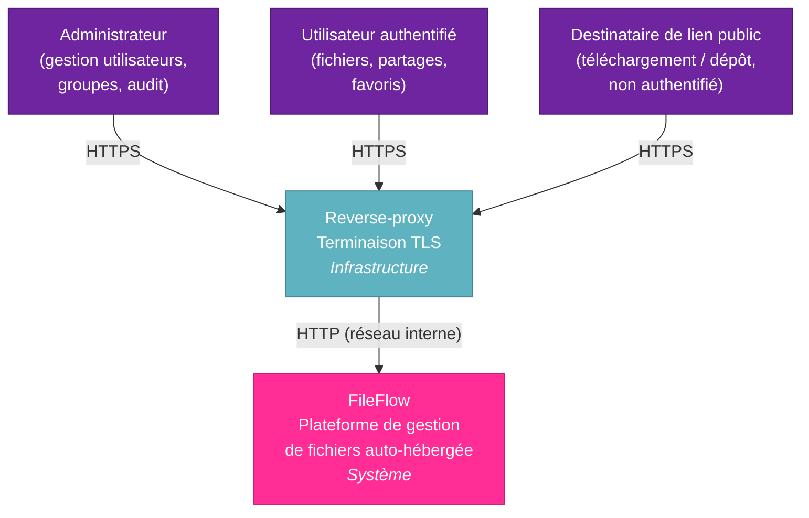
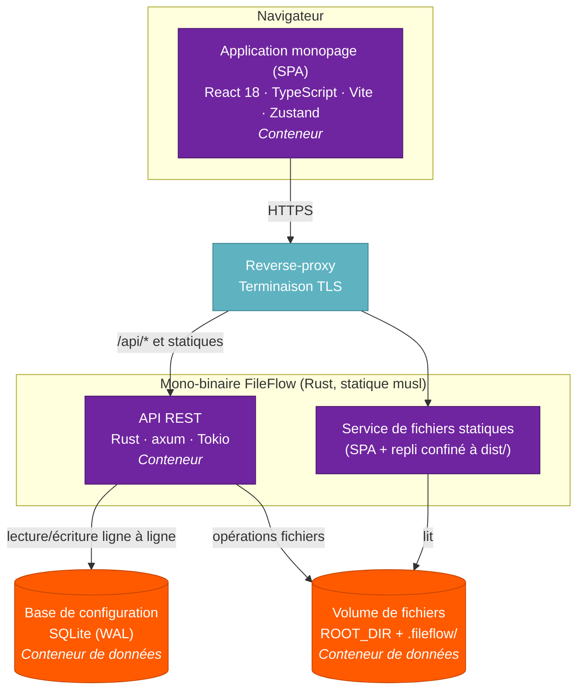
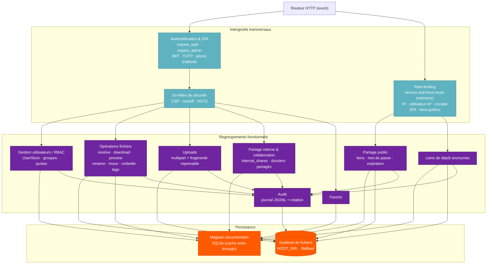
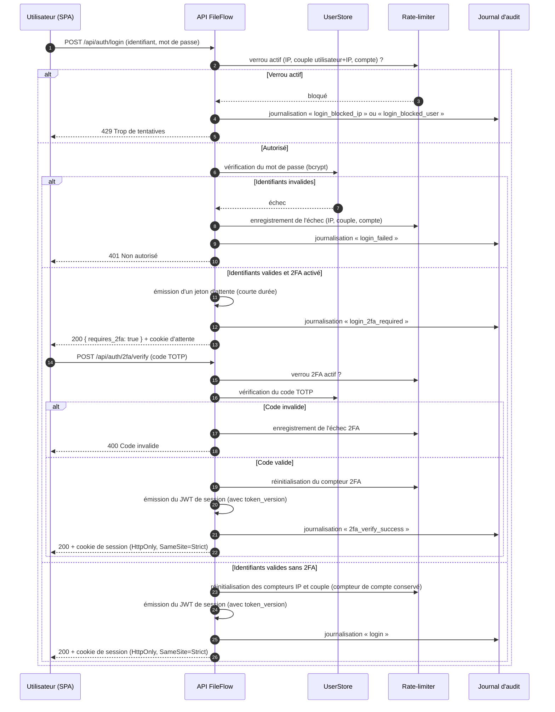

# Diagrammes d'architecture (modèle C4) — FileFlow

| | |
|---|---|
| **Document** | Diagrammes d'architecture — modèle C4 |
| **Produit** | FileFlow — Plateforme de gestion de fichiers auto-hébergée |
| **Version** | 1.1 |
| **Date** | 27 octobre 2026 |
| **Statut** | Validé |
| **Propriétaire** | Driss OUAAZIZ — Software Architect |
| **Classification** | Interne |

---

## Table des matières

1. [Introduction](#1-introduction)
2. [Niveau 1 — Diagramme de contexte](#2-niveau-1--diagramme-de-contexte)
3. [Niveau 2 — Diagramme de conteneurs](#3-niveau-2--diagramme-de-conteneurs)
4. [Niveau 3 — Diagramme de composants de l'API](#4-niveau-3--diagramme-de-composants-de-lapi)
5. [Vue dynamique — Séquence d'authentification](#5-vue-dynamique--séquence-dauthentification)
6. [Références](#6-références)

---

## 1. Introduction

Ce document présente l'architecture de FileFlow selon le **modèle C4** de Simon Brown, qui décrit un système à quatre niveaux de zoom successifs : le **Contexte**, les **Conteneurs**, les **Composants** et le **Code**. Les trois premiers niveaux sont documentés ici, complétés d'une **vue dynamique** décrivant un scénario clé.

Les diagrammes sont exprimés en notation Mermaid afin d'être rendus directement dans les outils de revue. Une vue dynamique de séquence complète l'ensemble, conformément aux usages UML.

---

## 2. Niveau 1 — Diagramme de contexte

Le diagramme de contexte situe FileFlow dans son environnement : les catégories d'utilisateurs qui interagissent avec le système et les éléments d'infrastructure qui l'entourent. Trois profils d'acteurs sont distingués — l'**administrateur**, l'**utilisateur authentifié** et le **destinataire d'un lien public** (non authentifié). L'accès transite systématiquement par un **reverse-proxy** assurant la terminaison TLS.

---

## 3. Niveau 2 — Diagramme de conteneurs

Le diagramme de conteneurs ouvre la boîte « FileFlow ». Le produit se distribue en un **mono-binaire** qui expose à la fois l'API REST et sert le SPA. Sur le plan logique, on distingue toutefois plusieurs conteneurs : l'**application monopage** exécutée dans le navigateur, l'**API** au sein du binaire, la **base SQLite** embarquée et le **volume de fichiers** persistant.

---

## 4. Niveau 3 — Diagramme de composants de l'API

Le diagramme de composants détaille l'organisation interne de l'API. Les requêtes traversent d'abord les **intergiciels transversaux** (authentification, en-têtes de sécurité), puis sont acheminées vers le regroupement fonctionnel concerné. Les liens publics et les demandes de dépôt, servis sans authentification, sont protégés par le verrou des mots de passe de liens (clés par lien et par adresse IP). Tous les regroupements s'appuient sur la **couche de persistance** (magasin documentaire SQLite et système de fichiers) et alimentent le **journal d'audit**.

---

## 5. Vue dynamique — Séquence d'authentification

La vue dynamique décrit le scénario d'authentification, incluant le second facteur TOTP. L'authentification par mot de passe, lorsque le double facteur est activé, ne délivre pas directement une session mais un **jeton d'attente** de courte durée, échangé contre une session complète après vérification du code TOTP.

---

## 6. Références

- **C4 Model** — Simon Brown (c4model.com).
- **ArchiMate** — Langage de modélisation d'architecture d'entreprise (The Open Group).
- **UML** — *Unified Modeling Language* (Object Management Group).
- **RFC 6238** — *TOTP: Time-Based One-Time Password Algorithm.*
